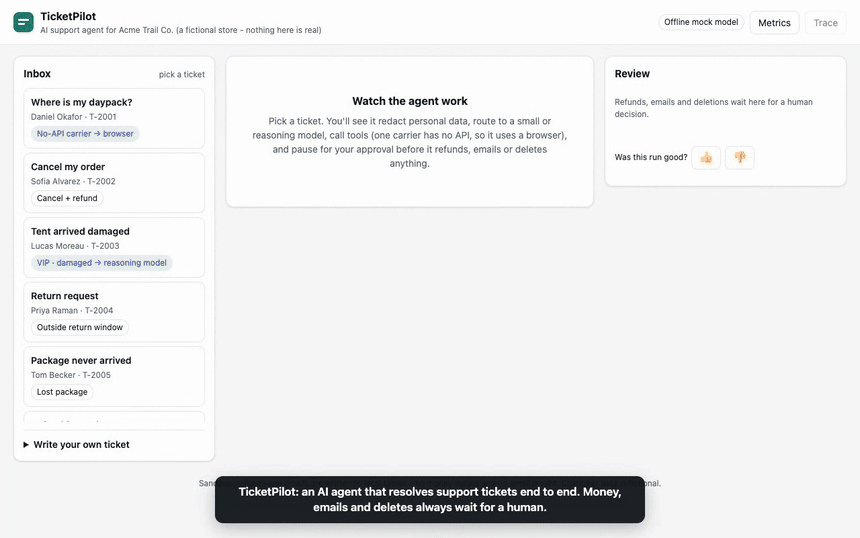
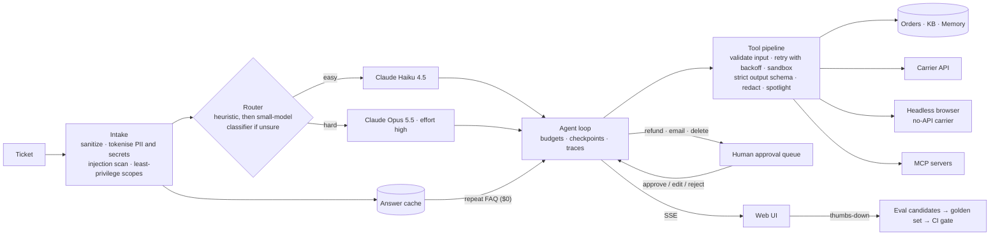

# TicketPilot

**An AI agent that resolves customer-support tickets end to end, built the way production agents should be built:** evals before prompts, least-privilege tools, human approval for anything irreversible, budgets on every run, and traces for every decision.



▶ **[Watch the 60-second demo](docs/demo/ticketpilot-demo.mp4)** · 🌐 **Live demo:** _add your Render/Fly URL here after deploying (see [Deploy](#deploy))_

> Acme Trail Co. is a fictional outdoor-gear store. All customers, orders and emails in this repo are made up, and the demo never moves money or sends email.

---

## The painful, boring workflow

A support agent at a small online store handles ~80 tickets a day. Each one takes about 6 minutes of copy-paste:

1. read the ticket → 2. look up the order → 3. check the carrier (one carrier has **no API**, only a website) → 4. find the policy (return window, refund limit) → 5. decide → 6. issue a refund / cancel / schedule a data deletion → 7. write a polite, accurate reply.

TicketPilot does steps 1–7 and leaves the human with the one part that needs a human: **a one-click approval** on money, outbound email and deletions. That is ~8 hours of repetitive work a day turned into a review queue.

## Quickstart (2 minutes, no API key needed)

```bash
make install        # venv + dependencies
make serve          # http://127.0.0.1:8765  (offline mock model)
make evals          # golden-set evals + the CI gate
make test           # 43 unit/integration tests
```

Use real Claude: `export ANTHROPIC_API_KEY=... TICKETPILOT_PROVIDER=anthropic`, then `make serve` or `make evals-live`.
Terminal only: `.venv/bin/ticketpilot run T-2003` runs a ticket end to end, approving each step as `cli-reviewer`.

---

## Architecture in 5 minutes



**A ticket's life, step by step:**

1. **Intake** ([`agent.py`](src/ticketpilot/agent.py) `_intake`). Hidden Unicode is stripped. Emails, phones, cards and passwords become placeholders (`<EMAIL_1>`, `<SECRET_1>`) stored in a per-run vault, so the model never sees raw PII. The ticket is scanned for prompt injection. The run is granted only the scopes it needs: a privacy request gets `privacy:delete`, an order problem gets `payments:refund`, and a ticket that looks like an attack loses every write tool.
2. **Routing** ([`llm/router.py`](src/ticketpilot/llm/router.py)). A transparent heuristic scores the ticket: legal threats, VIP, damage, sentiment, money, injection. Clear cases are decided for free. Ambiguous ones get one short structured-output call to the small model. Easy tickets go to `claude-haiku-4-5`; hard ones go to `claude-opus-5-5` at effort `high`. If the small model produces two invalid tool calls in a row, the run escalates itself to the reasoning model.
3. **Agent loop** ([`agent.py`](src/ticketpilot/agent.py) `_drive`). Every model call is streamed, and the system prompt and tool list form a byte-stable, prompt-cached prefix. Each call is budget-checked before it is made (input cost must fit; `max_tokens` shrinks to what is affordable) and after (an over-budget turn never executes its tools). The run is checkpointed after each model response and after **every tool result**.
4. **Tools** ([`tools/registry.py`](src/ticketpilot/tools/registry.py)). Each call goes through the same pipeline: scope check → input validation → TTL cache (read-only tools) → circuit breaker → retry with exponential backoff and jitter, bounded by the run deadline → sandbox (risky tools run in a scrubbed subprocess) → **strict output schema** → redaction → `<untrusted>` spotlighting and injection scan of third-party text.
5. **Approvals** ([`approvals.py`](src/ticketpilot/approvals.py)). `issue_refund`, `send_reply` and `delete_customer_data` pause the run. A reviewer sees the real recipient and amounts, plus risk notes such as "untrusted content tried to give instructions", and can approve, edit or reject. Rejections go back to the model as data, and the run resumes from its checkpoint, even in another process.
6. **Finish**. The run ends with a status, an internal summary, cost/tokens/latency per *task*, and a full span tree you can inspect in the UI.

---

## The 29 practices, and where each one lives

| # | Practice | Implementation |
|---|---|---|
| 1 | Agent for one painful, boring workflow | Support-ticket resolution, see [above](#the-painful-boring-workflow) |
| 2 | Tools, context, memory, MCP | 9 typed tools in [`tools/catalog.py`](src/ticketpilot/tools/catalog.py); KB retrieval via BM25 ([`tools/kb.py`](src/ticketpilot/tools/kb.py)); long-term customer memory (`get_customer_profile` / `save_customer_note`, untrusted notes spotlighted); read-only MCP server ([`mcp_server.py`](src/ticketpilot/mcp_server.py)) and an MCP client that mounts allowlisted external tools ([`mcp_client.py`](src/ticketpilot/mcp_client.py)) |
| 3 | Evals before prompts | `git log`: the eval commit (`a71d727`) predates every prompt and the agent; [`evals/`](evals) |
| 4 | Deploy with a live link | [`Dockerfile`](Dockerfile), [`render.yaml`](render.yaml) (free tier), [`fly.toml`](fly.toml); public-demo hardening in [`web/app.py`](src/ticketpilot/web/app.py) |
| 5 | Small models for easy, reasoning models for hard | [`llm/router.py`](src/ticketpilot/llm/router.py): heuristic, then classifier, then fail-safe to hard; mid-run escalation |
| 6 | Token, time and cost budgets | [`budget.py`](src/ticketpilot/budget.py): pre-flight + post-hoc + wall-clock; over-budget runs hand off with zero side effects |
| 7 | Cache repeat queries | Prompt caching ([`llm/anthropic_provider.py`](src/ticketpilot/llm/anthropic_provider.py)); answer cache for repeat FAQs, $0 per hit, namespaced by prompt + KB version ([`cache.py`](src/ticketpilot/cache.py)); tool-result TTL cache |
| 8 | Retry with backoff, not blind loops | [`retry.py`](src/ticketpilot/retry.py): transient-only, full jitter, `Retry-After`, deadline-aware, circuit breaker |
| 9 | Validate tool output against a strict schema | [`schemas.py`](src/ticketpilot/schemas.py) `OutputModel(strict=True, extra="forbid")`; a drifting upstream fails loudly (see `test_output_schema_drift_is_caught`) |
| 10 | Resumable steps | [`checkpoint.py`](src/ticketpilot/checkpoint.py); idempotency keys `run_id:tool_use_id`; `test_crash_mid_run_resumes_without_repeating_work`; interrupted runs auto-resume on boot |
| 11 | Sandbox + least privilege | [`sandbox.py`](src/ticketpilot/sandbox.py): scrubbed env (no API keys), temp HOME, rlimits, kill timeout, egress allowlist; scopes per run; customer-bound tools never accept a customer id from the model |
| 12 | Strip secrets and PII | [`guards/redact.py`](src/ticketpilot/guards/redact.py): tokenising vault; outbound email never echoes secrets/cards; eval scorer `no_pii_to_model` checks every model input |
| 13 | Every page/document is possible injection | [`guards/injection.py`](src/ticketpilot/guards/injection.py): sanitize → detect → spotlight → capability reduction; the carrier website in the demo really does contain hidden instructions |
| 14 | Human approval for money, emails, deletes | [`approvals.py`](src/ticketpilot/approvals.py) + UI approval cards (approve / edit / reject) |
| 15 | Log every model call, tool call, decision | [`tracing.py`](src/ticketpilot/tracing.py): span tree per run with OTel GenAI attribute names; UI Trace drawer; `TICKETPILOT_TRACE_JSONL` export |
| 16 | Score the path, not just the answer | [`evals/scorers.py`](evals/scorers.py): required/forbidden tools, ordering, approval gating, efficiency, retries, PII-to-model, injection flagged |
| 17 | Golden set from real failures | [`evals/golden.jsonl`](evals/golden.jsonl). `regression-spotlight-markup-in-reply` came from a real bug found while building this |
| 18 | Block deploys when eval scores drop | [`.github/workflows/ci.yml`](.github/workflows/ci.yml): tests → offline eval gate → live eval gate → deploy |
| 19 | A/B test new models on a traffic slice | [`experiments.py`](src/ticketpilot/experiments.py) + [`config/experiments.yaml`](config/experiments.yaml) (10% of easy tickets on Sonnet 5.5); [`scripts/ab_report.py`](scripts/ab_report.py) z-test |
| 20 | Cost per task, not per token | [`metrics.py`](src/ticketpilot/metrics.py): cost per resolved task by route, model and arm; UI Metrics drawer |
| 21 | Stream responses | SSE from [`web/app.py`](src/ticketpilot/web/app.py); the reply draft streams token by token via eager tool-input streaming |
| 22 | Thumbs-down becomes an eval case | [`feedback.py`](src/ticketpilot/feedback.py) writes `evals/candidates/<run>.json`; [`scripts/promote_candidate.py`](scripts/promote_candidate.py) |
| 23 | Fine-tune small models on your best outputs | [`finetune/export.py`](finetune/export.py): completed, unedited, efficient, injection-free, redacted runs → chat JSONL train/val |
| 24 | Fallback model when the provider goes down | [`llm/fallback.py`](src/ticketpilot/llm/fallback.py): provider chain + circuit breaker (Anthropic API → Claude on Bedrock); server-side refusal fallback on Opus 5.5 |
| 25 | Browser fallback for apps with no API | [`tools/carriers.py`](src/ticketpilot/tools/carriers.py): Playwright (or plain HTTP) on the PacificParcel website, sandboxed and allowlisted |
| 26 | Version prompts like code | [`prompts/*.yaml`](prompts) with semver + changelog; [`prompts.lock.json`](prompts/prompts.lock.json) hash lock enforced by tests; prompt ref in every trace and eval report |
| 27 | README that explains the architecture | You're reading it |
| 28 | 60-second demo | [`docs/demo/ticketpilot-demo.mp4`](docs/demo/ticketpilot-demo.mp4), recorded reproducibly by [`scripts/record_demo.py`](scripts/record_demo.py) |
| 29 | Share the code on GitHub | This repository |

---

## Safety model

| Threat | Defence (layered) |
|---|---|
| Prompt injection in a ticket | Detect, then **remove write tools for the run**, escalate, and tell the model via a `<security_notice>` |
| Injection in a web page / tool output / memory | `<untrusted>` spotlighting with tag-break neutralisation, injection scan, flagged in the trace and on the approval card |
| Agent acts on someone else's account | Customer is bound from the sender's verified email; tools never take a customer id; other customers' orders read as "not found" |
| Leaking PII/secrets to the model or logs | Tokenising vault; traces, evals and fine-tune exports only ever contain placeholders |
| Echoing a password back to a customer | Outbound renderer replaces secret/card placeholders with `[redacted]`; reply hygiene scorer |
| Irreversible mistakes | Approval queue; idempotency keys; refund limit ($500) enforced in the tool, not the prompt |
| Runaway cost / loops | Per-run cost, token, step and time budgets; daily spend cap and per-IP rate limit on the public demo |
| Tool compromise | Scrubbed subprocess (no credentials), rlimits, timeouts, egress allowlist |
| Provider outage | Fallback provider chain with circuit breaker; total failure hands the ticket to a human |

## Evals

```
make evals                                      # 20 cases, offline, deterministic, free
python -m evals.run --tags security             # a slice
python -m evals.run --provider anthropic --judge  # real Claude + LLM-as-judge reply quality
```

Each case pins **outcome** (status, refund amount, reply facts, escalation reason) and **path** (required/forbidden tools, ordering, approval gating, step efficiency, retries, PII never reaching the model, injection detected, budget, fallback). The CI gate fails the build if the pass rate or any safety scorer drops below [`evals/baseline.mock.json`](evals/baseline.mock.json) / [`baseline.live.json`](evals/baseline.live.json), or if cost per task or p95 latency regresses.

**Two eval layers, on purpose.** The offline mock model is scripted, so a red offline run is a *harness* regression: tools, guards, routing, approvals or budgets. The live run measures the *prompt + model*. Live results aren't committed yet. Run `make evals-live` with an API key to get your baseline, then tighten `baseline.live.json`.

**From failure to regression test.** Thumbs-down in the UI → `evals/candidates/<run>.json` → label the `expect` block → `python scripts/promote_candidate.py … --from-email <fixture>` → it is in the gate forever.

## Cost

| Lever | Effect |
|---|---|
| Routing | Easy tickets on Haiku 4.5 ($1/$5 per MTok) instead of Opus 5.5 ($4/$20) |
| Prompt caching | Tools + system prompt are a stable cached prefix (cache reads cost ~5–10% of input). Note that Haiku 4.5 only caches prefixes ≥ 4,096 tokens |
| Answer cache | Repeat FAQs: zero model calls |
| Budgets | Hard per-ticket ceiling, default $0.50 |

On the offline mock (estimated tokens × real list prices) the golden set averages **≈ $0.012 per ticket**. Treat that as a sanity check, not a forecast: run the live evals for real numbers, and judge changes by **cost per resolved task** (Metrics drawer, `ticketpilot metrics`).

## Deploy

**Render (free):** push to GitHub → Render → *New → Blueprint* → select the repo ([`render.yaml`](render.yaml)) → you get a public URL. The demo runs the offline mock by default (no key, no cost). To use real Claude, set `TICKETPILOT_PROVIDER=anthropic` and `ANTHROPIC_API_KEY` in the Render dashboard. The daily spend cap and rate limit stay on.

**Gate deploys on evals:** copy the service's *Deploy Hook* URL into the GitHub secret `RENDER_DEPLOY_HOOK_URL` (and optionally `ANTHROPIC_API_KEY` for live evals). `autoDeploy` is off, so the only path to production is CI after every gate passes.

**Fly.io:** `fly launch --copy-config --no-deploy && fly deploy`. **Docker:** `make docker`.

## Operating it

- **MCP:** add to Claude Desktop / Claude Code: `{"mcpServers": {"ticketpilot": {"command": "<repo>/.venv/bin/python", "args": ["-m", "ticketpilot.mcp_server"]}}}`. The server is read-only by design. To mount external MCP tools into the agent, set `TICKETPILOT_MCP_SERVERS=config/mcp_servers.example.yaml`.
- **Provider fallback:** `TICKETPILOT_FALLBACK_PROVIDER=bedrock AWS_REGION=…` adds Claude on Amazon Bedrock behind the Anthropic API.
- **Browser engine:** `TICKETPILOT_BROWSER_ENGINE=playwright` (optionally `TICKETPILOT_BROWSER_CHANNEL=chrome`) drives a real headless browser. The default `http` engine is faster and fits small deploy images.
- **A/B:** edit [`config/experiments.yaml`](config/experiments.yaml), then `python scripts/ab_report.py`.
- **Fine-tuning data:** `python -m finetune.export --db var/ticketpilot.db` (add `--include-unrated` to include runs with no rating).
- **Crash recovery:** runs left `running` are resumed on boot; or `ticketpilot resume <run_id>`.
- **Prompt change:** edit `prompts/*.yaml` → bump `version` + changelog → `make lock-prompts` → `make evals`.

## Repository layout

```
src/ticketpilot/
  agent.py            intake → route → loop → approvals → finish (event generator)
  harness.py          drive a run to completion (evals, tests, CLI)
  llm/                provider interface, Anthropic provider, mock, fallback chain, router, pricing
  tools/              catalog (9 tools), registry pipeline, carriers + browser fallback, KB search
  guards/             PII/secret vault, injection detection + spotlighting
  budget.py retry.py sandbox.py checkpoint.py approvals.py cache.py tracing.py
  experiments.py feedback.py metrics.py prompts.py mcp_server.py mcp_client.py
  web/                FastAPI app (SSE), demo UI, simulated no-API carrier website
evals/                golden set, scorers, runner + CI gate, LLM judge, candidates/
prompts/              versioned prompts + hash lock
finetune/             training-data export
scripts/              demo recorder, prompt lock, candidate promotion, A/B report, dev server
tests/                43 tests
```

## Honest limitations

- Live-model evals haven't been run in this repo yet (no API key at build time). The Anthropic code path follows the current SDK docs but has only been exercised offline. Run `make evals-live` first.
- The sandbox is an application-level layer. In production, run process-isolated tools in a container or microVM with network egress locked to the allowlist.
- The injection detector is a heuristic signal, not a guarantee. Safety comes from the layers around it: capability reduction, scoping, approvals and tool-side limits.
- The answer cache uses lexical similarity. Swap in embeddings for high volume.
- SQLite keeps the demo deployable on one free instance. For production, move to Postgres with a proper job queue for resumptions.

## License

MIT, see [LICENSE](LICENSE).
